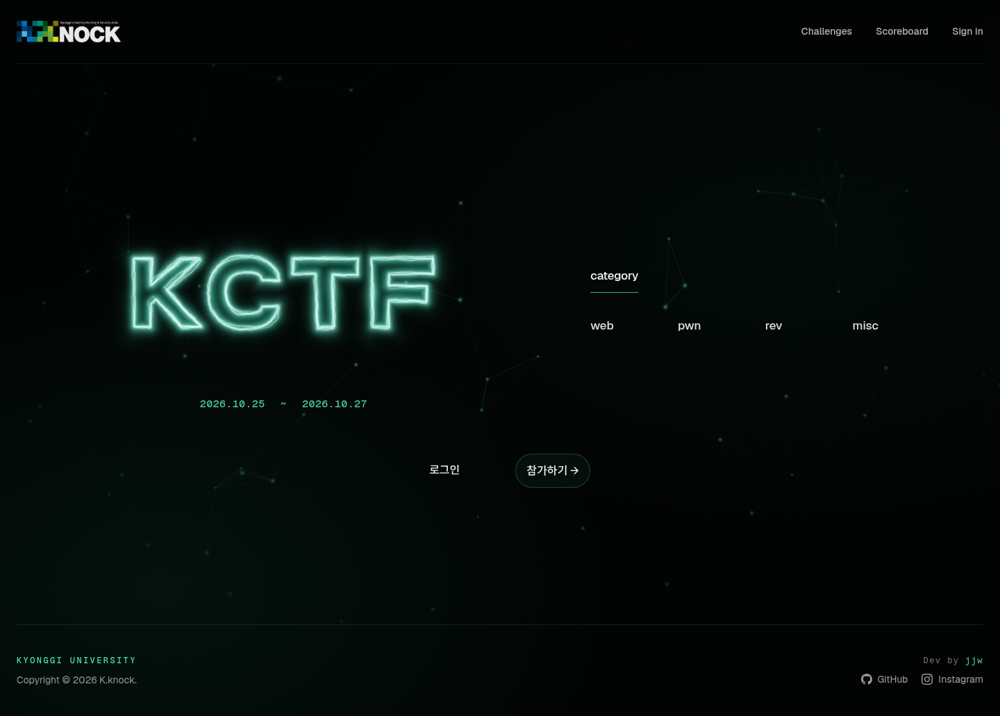
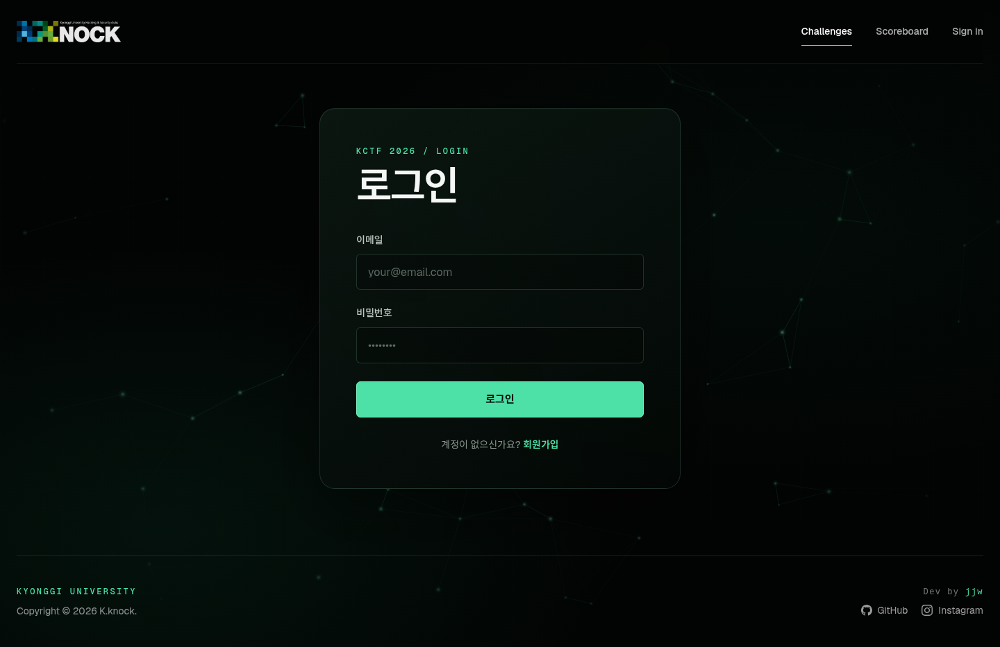

# KCTF Platform

KCTF 플랫폼으로, 공정하고 효율적인 대회 운영을 지원합니다.

## Tech Stack

- **Framework**: Next.js 16.4 (TypeScript, App Router)
- **UI**: React 19, Tailwind CSS, custom KCTF design system
- **Database**: PostgreSQL 16
- **ORM**: Prisma 7 with the PostgreSQL driver adapter
- **Web Server**: Caddy (TLS/reverse proxy) or Nginx
- **Infrastructure**: Docker Compose

## Prerequisites

- Docker Engine and Docker Compose v2
- A domain whose A/AAAA record points to the server (production)
- Node.js 22+ and npm (local development only)

## Installation and running

Docker Compose is the simplest way to run the platform locally:

```bash
git clone git@github.com:jjw0-0/KCTF_Webpage.git
cd KCTF_Webpage
cp .env.example .env
docker compose up --build
```

Update the values in `.env` before starting, then open
`http://localhost:3000`. The stack includes PostgreSQL and the Compose
instancer, so the Docker socket must be available on the host. To run Next.js directly while keeping PostgreSQL in
Docker:

```bash
npm install
docker compose up -d postgres
npm run prisma:migrate
npm run dev
```

## Project Structure

```
/
├── public/                  # Static assets
├── src/
│   ├── app/                 # Next.js App Router
│   │   ├── (auth)/          # Auth pages
│   │   ├── ctf/             # Participant challenge board
│   │   ├── admin/           # Admin dashboard
│   │   ├── profile/         # Participant profile
│   │   ├── scoreboard/      # Individual rankings
│   │   └── api/             # API routes
│   ├── lib/                 # Libraries and utilities
│   ├── components/          # Shared UI components
├── prisma/
│   ├── schema.prisma        # Prisma schema
│   └── migrations/          # Database migrations
├── docker-compose.yml       # Docker Compose configuration
├── docker-compose.prod.yml  # Production stack
├── Dockerfile               # Next.js Docker image
└── nginx/
    └── conf.d/              # Nginx configuration (서버에 복사하여 사용)
```

## Screenshots



The landing page summarizes the event schedule and challenge categories, with
direct links to registration, challenges, and the scoreboard.



Protected challenge routes redirect unauthenticated visitors to the shared
login screen before showing participant content.

## Git Workflow

CI/CD는 추후 추가 예정입니다.

## Production deployment

A new server can be initialized with one command. Point DNS at the server first,
then allow inbound TCP 80, 443, and 10000-19999 (plus UDP 443):

```bash
git clone git@github.com:jjw0-0/KCTF_Webpage.git
cd KCTF_Webpage
./scripts/install.sh ctf.example.com
```

The installer generates secrets in the ignored, owner-readable
`.env.prod.local`, creates an initial administrator, applies migrations, starts
the bundled Caddy proxy, and launches an empty challenge catalog. It prints the
initial administrator password once. No existing database or challenge data is
required. On ARM64 hosts the instancer registers amd64 emulation at startup so
x86-only challenge images can be built and run. This narrowly scoped setup uses
a pinned privileged `binfmt` helper container; challenge containers themselves
remain unprivileged.

If the server already has a reverse proxy, copy `.env.example` to
`.env.prod.local`, set its production values, and use the deployment script.
The app listens on host loopback port `3020` in this mode:

```bash
./scripts/deploy-prod.sh
```

Required variables are `POSTGRES_USER`, `POSTGRES_PASSWORD`, `POSTGRES_DB`, and
`NEXTAUTH_SECRET`, `INSTANCE_FLAG_SECRET`, `KCTF_INSTANCER_TOKEN`, `DOMAIN`, and
`INSTANCER_PUBLIC_HOST`. Keep them in `.env.prod.local`, which is excluded by
the repository's `.env*.local` ignore rule.

To bootstrap an administrator, run the seed command with `ADMIN_EMAIL`,
`ADMIN_USERNAME`, and a 14+ character `ADMIN_INITIAL_PASSWORD` in the migration
container environment.

The seed creates categories but no sample problems. Create problems from the
administrator's **Challenges** screen. Static flags are stored as keyed digests
and are never returned by the API.

## Challenge instances

The administrator can attach two separate ZIP files to a problem:

- **풀이자 제공 ZIP**: optional download shown in the participant problem modal.
- **VM 배포 ZIP**: shown only when **VM 사용** is enabled; kept private and built
  by the instancer.

The deployment archive may use any `.zip` filename. In the administrator form,
enter the problem name, flag, and the one internal TCP port participants should
reach, then choose the build mode:

- Leave **Docker Compose 사용** unchecked for a root-level `Dockerfile`. The
  instancer calls `docker build` directly and does not create a Compose file to
  build it.
- Enable **Docker Compose 사용** when the archive contains an existing
  root-level `docker-compose.yml`. The instancer finds the single service that
  declares the entered port.

Challenge authors do not write `challenge.yaml` in either mode.

```yaml
# docker-compose.yml
services:
  web:
    build: ./web
    depends_on: [db]
    expose: ["8080"]
  db:
    image: postgres:16-alpine
    volumes: [data:/var/lib/postgresql/data]
volumes:
  data: {}
```

VM problems use the flag entered in the administrator form, so an existing
deployment bundle and its original flag file can run unchanged. Legacy
amd64 Redis 5.0.7 images receive an ARM64 runtime compatibility adjustment
automatically without changing the uploaded source. Compose mode may use
multiple services, images, build contexts, networks, named
volumes, and project-relative read-only bind mounts. Declared published ports
are ignored because the instancer exposes only the manifest entry port. Absolute
host paths, privileged mode, Docker sockets, host
namespaces, device access, capability additions, external networks/volumes,
scaling, and user-defined resource overrides are rejected. The instancer owns
the public port and applies CPU, memory, PID, dropped-capability, and
`no-new-privileges` limits. Every challenge network is forced to be internal;
a small read-only gateway container accepts the public port and forwards only
to the selected entry service, so compromised challenge containers cannot use
the gateway for general Internet, host, or cross-instance access.

Each player may run one instance across the entire platform. Starting another
problem replaces their current instance; any number of different players may
run the same problem. Instances expire after `INSTANCER_TTL_MS` and there is no
platform-wide instance count limit. Capacity is therefore bounded only by the
host, so production operators should monitor Docker and choose conservative
per-instance limits. Build metadata and uploaded deployment sources live in
`/var/lib/kctf-instancer` on the Docker host.

## Challenge content

The challenge board (`/ctf`) uses the network background and supports category
filtering. Reduced-motion preferences disable card movement and freeze the
background. Geist Sans/Mono are self-hosted from Vercel's official `geist`
package; Noto Sans KR supplies the Korean glyphs missing from Geist. The KCTF
brand lettering retains its display face.

The administrator's Challenges form supports an author name, an optional file URL,
and Markdown descriptions with a live preview. Existing plain-text descriptions
continue to work. Use blank lines between media and text:

```markdown
## 문제 설명
텍스트와 **강조**, 목록, 코드 블록을 사용할 수 있습니다.


[문제 영상](https://example.com/demo.mp4)

[참고 영상](https://www.youtube.com/watch?v=VIDEO_ID)
```

MP4, WebM, OGV and M4V links render native video controls; YouTube and Vimeo
links render embedded players. Raw HTML is not rendered. Media and attachment
URLs must use HTTP(S) or a same-site path starting with `/`. Upload files to
your hosting first, then use their URL. A missing file or VM slug hides that
section in the participant dialog. The description scrolls while the flag
submission form stays visible.

## License

Copyright © 2025 K.knock
